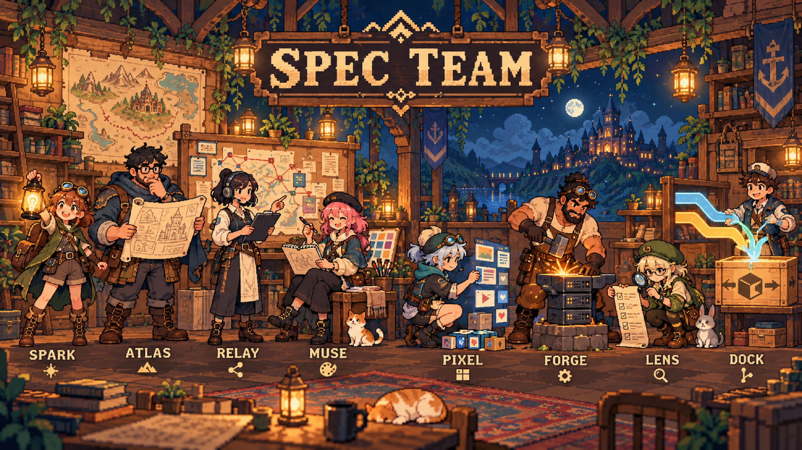
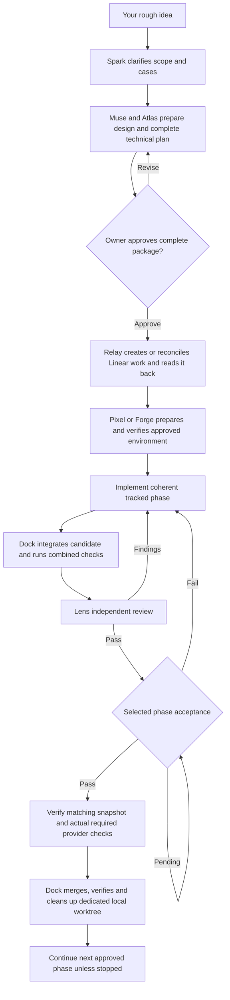

# Spec Team

**A reusable spec-driven agent workflow for full-stack projects.**

[](LICENSE)
[](#requirements)
[](https://github.com/kin2001/spec-driven-starter-kit/actions/workflows/checks.yml)

This repository provides one command-driven skill, eight role profiles, shared operating references, and templates for developing a product idea into an approved specification and plan, then carrying approved work through Linear, implementation, independent review, acceptance, merge, and cleanup. It contains no sample product or orchestration server.

Local installation and instruction checks were exercised on Windows with Python 3.11.9 and 3.14.5, including independent review and disposable-project acceptance. Actual model routing, host menus and live Linear/provider delivery remain project-specific checks. See [validation and limitations](#validation-and-limitations).

## Contents

- [Requirements](#requirements)
- [Download or clone](#download-or-clone)
- [Quick start](#quick-start)
- [Actions](#actions)
- [Example interaction](#example-interaction)
- [Product dependencies and sign-in reuse](#product-dependencies-and-sign-in-reuse)
- [Roles and model settings](#roles-and-model-settings)
- [Dependencies and host limits](#dependencies-and-host-limits)
- [Delivery flow](#delivery-flow)
- [Linear tracking](#linear-tracking)
- [Work and ownership model](#work-and-ownership-model)
- [Existing projects and recovery](#existing-projects-and-recovery)
- [Project memory and changes](#project-memory-and-changes)
- [Troubleshooting](#troubleshooting)
- [Validation and limitations](#validation-and-limitations)
- [Repository map](#repository-map)
- [Contributing and license](#contributing-and-license)

## Requirements

- **Python 3.11+** for the setup and helpers. They use the standard library; normal setup needs no `pip install`.
- **Git** for source delivery and worktrees. A ZIP is an alternative for obtaining the kit files.
- **A local coding host** with filesystem/shell tools, skill discovery and suitable agent/model controls.
- **Access to the requested role models/effort settings** through your host account. The repository does not provide a model service or usage credits.
- **Authenticated Linear and Git-provider tools** before actions that need them. Planning can identify missing access; it cannot invent resources.
- **Your product stack's requirements**, agreed in its plan. Node, Docker, database servers and cloud accounts are not universal kit prerequisites.

The primary intended environment is Codex with a local project. ChatGPT Desktop local Work/Codex is intended where it exposes the required local project tools and agent controls; validate that host independently. Ordinary chat without those tools cannot be assumed to execute local delivery.

Official documentation covers [local skills](https://learn.chatgpt.com/docs/build-skills) and [custom Codex agents](https://learn.chatgpt.com/docs/agent-configuration/subagents). Repository skills use `.agents/skills`; project agents use `.codex/agents`. Custom agents inherit parent permissions and connections. Copying files does not establish enforced isolation or observed model routing.

## Download or clone

### Clone with Git

Run from a directory where you keep reusable tools:

```powershell
git clone https://github.com/kin2001/spec-driven-starter-kit.git
cd spec-driven-starter-kit
```

Clone once and keep this checkout separate from your product. Run its installer for each product that should use the workflow.

### Download a ZIP

On GitHub choose **Code -> Download ZIP** or [download the main-branch ZIP](https://github.com/kin2001/spec-driven-starter-kit/archive/refs/heads/main.zip), extract it and open a terminal in the extracted kit folder. Keep the `.agents` and `.codex` folders; they contain the workflow. The setup commands below also work from an extracted kit.

Downloading needs network access. The setup script uses bundled archives offline. Later model calls, provider access and product dependency installs have their own network requirements.

## Quick start

Choose the required Relay model, `gpt-6.1-sol` with `high` reasoning effort, in the active host's model selector. Role files request each role's model and effort; a prompt cannot change the parent model or prove that the host honored a request. The setup CLI uses Python's standard library and requires Python 3.11 or newer; it does not install an interpreter.

Run from the kit folder. Replace the destination below with your product's actual path. First omit `--apply` to preview without writing; then apply when the plan has no unresolved conflicts:

```powershell
python .agents/skills/spec-team/scripts/setup.py --project "D:/Projects/my-app" --apply
```

Omitting `--apply` previews planned file operations and conflicts. Bootstrap does not create product work or external resources. Once the skill is installed, invoke its `setup` action to inspect the three bundled dependency families and install missing project-local skills. The kit MIT notice is also retained inside `.agents/skills/spec-team/LICENSE`, without replacing the product's root license. Setup is additive and reuses existing copies; it reports differing/conflicting files without overwriting them.

Open **the destination product folder**, not the kit checkout, in your coding host. Once it discovers the skill, select **Spec Team** and give an action, or use the Codex-style `$spec-team ACTION` invocation. Other hosts use their own supported skill selection/mention.

```text
$spec-team setup
$spec-team start <your rough product idea>
```

Review the complete specification and technical plan before issuing `$spec-team approve`. On Windows, `py -3.11` can replace `python` when the launcher selects the wrong version. For macOS/Linux, select a Python 3.11+ interpreter and local path:

```bash
python3 .agents/skills/spec-team/scripts/setup.py --project "$HOME/Projects/my-app" --apply
```

Windows is the locally exercised platform; verify other platforms' specific behavior.

The examples below are coding-chat actions, not terminal executables. The supported skill actions are documented below. The slash menu is host discovery behavior and must be checked in the actual host. These are skill instructions, not newly registered application commands or a background command server.

## Actions

| Action | What it does |
| --- | --- |
| no action / `help` | Read-only help, current stage, and valid next actions; never defaults to implementation. |
| `setup` | Check the kit and Superpowers, UI/UX Pro Max, and Ponytail. Install missing project-local files from the bundled pins when requested; reuse existing copies and report conflicts. No product work or external resources. |
| `start IDEA` | Reconcile the project, clarify consequential unknowns with Spark, prepare UX direction with Muse where relevant, and prepare the complete specification and technical plan with Atlas. Present the whole package for one owner approval. |
| `approve` | Apply an explicit owner approval only to the uniquely identified current package. Record separate hashes and paths for the spec and plan, using the same actual owner-message evidence. Continue only when real prerequisites are available. |
| `status` | Read-only current phase, task, role, evidence, blockers, references, and next action. |
| `stop` | Stop new dispatches and mutations, reconcile workers and in-flight results, preserve a checkpoint, then report stopped when quiescent. |
| `resume` | Reconcile current documents, Git, Linear, receipts, and ownership before continuing already authorized work. |
| `change REQUEST` | Assess impact, preserve existing work, and present a revised package for approval when the change is material. |
| `handoff DESTINATION` | On explicit owner instruction, quiesce and checkpoint the active run, release its claim, then let the intended supported session claim and reconcile that same run. |

Unknown actions show help and do nothing. Help, `status`, and copied approval text never authorize mutations. A repeated `start` grants no new permissions; it reconciles and reuses existing resources, then may continue only actions already authorized by current approval, ownership, and capability checks. It must not duplicate resources. One approval covers the current product specification and technical plan; each saved document still has its own immutable path and SHA-256 receipt. A changed document requires affected approval evidence to be revalidated. The older `spec_review` run state is accepted for compatibility, but it is not an extra required approval gate.

## Example interaction

```text
Owner: $spec-team start A meal-planning app for families. I have a rough feature list and a paper sketch.
Relay: I will inspect the repository and ask about choices that change user behavior or architecture.
Spark: Who uses the shared plan, and what happens when a family member changes a meal after shopping?
Owner: ...
Relay: The package is ready. Review the product specification and technical plan at these project-relative paths. Their saved SHA-256 values are ... and ... . No Linear resources or product changes have been made.
Owner: I approve this complete package: [unambiguous approval of the presented spec and plan]
Relay: I recorded that message as the approval evidence for both document receipts. The configured Linear workspace is not yet available, so the run remains in setup and no tickets or implementation were started.
```

If setup and required host/provider capabilities are configured, `approve` continues into idempotent Linear setup, reads the issues back, and assigns product environment preparation inside the first coherent implementation task. Pixel or Forge verifies existing installations, prepares the approved stack as needed and runs its required smoke checks before dependent feature work. Otherwise Relay reports the exact missing prerequisite and preserves the approved package. Linear authentication can be needed before ticket creation. Example wording is illustrative; it is never itself approval evidence.

## Product dependencies and sign-in reuse

Atlas includes runtime/package-manager versions, manifests/lockfiles, exact setup/verification commands, services, authentication and recovery in the plan you review. After approval and real Linear task readback, Relay coordinates preparation in the assigned worktree. No additional role, command or mandatory phase is needed. The kit's `setup` action still installs only agent skills.

Reuse verified compatible dependencies and native connector/CLI sessions. Each contributor uses their own account. Prefer OS-backed credentials; report insecure storage fallback and request focused user action when expiry, MFA or missing permissions requires it. Do not export browser sessions or copy tokens between worktrees/apps. When the application requires local secret files, preserve existing values, restrict access and verify ignore/tracking and output exclusions. Ignoring a file does not secure it or remove earlier commits.

Relay may keep only non-secret observations in ignored `.spec-team/local/environment.json` under the retained controller root; the [inert template](.agents/skills/spec-team/templates/environment.json) contains no credentials or readiness claims. `resume` verifies relevant inputs and live access before reuse rather than reinstalling or signing in every time. See the [environment contract and ten normal, edge and worst cases](.agents/skills/spec-team/references/environment.md), including interruption, wrong account, unsafe hooks, secret exposure and worktree handoff. Credentials remain local to each user and are excluded from kit distribution.

## Roles and model settings

| Role | Main responsibility | Requested model / effort |
| --- | --- | --- |
| Spark | Product discovery, scope, use cases, acceptance criteria | `gpt-6.1-sol` / `high` |
| Atlas | Architecture, stack, contracts, security approach, technical plan | `gpt-6.1-sol` / `high` |
| Relay | Single controller; setup, Linear writes, dispatch, status, ownership | `gpt-6.1-sol` / `medium` |
| Muse | UX flows, visual direction, interaction states, accessibility | `gpt-6-luna` / `max` |
| Pixel | Frontend implementation and focused checks | `gpt-6-luna` / `max` |
| Forge | Backend, data, permissions, integrations, focused checks | `gpt-6.1-sol` / `medium` |
| Lens | Independent specification/code review and selected acceptance | `gpt-6.1-sol` / `high` |
| Dock | Integration, combined checks, verified merge and local cleanup | `gpt-6-luna` / `max` |

These are exact requested defaults, not proof of observed routing. Check actual host selectors and report observed model/effort separately. Sol Extra high is the ceiling; escalate only for a diagnosed high-risk or difficult issue, record why, and return routine work to its default. Access errors and missing credentials do not justify a model escalation. Never change global model settings or claim an agent profile overrides the parent session.

## Context, communication, and usage

Use a fresh, focused worker context for each meaningful implementation issue and independent Lens review. Keep related tiny steps together and return fixes to their current owner when practical. Relay receives concise results and evidence references rather than raw logs, screenshots or full worker histories. Read relevant skill sections once per context; recheck changed or lost inputs. Workers inspect connected source as needed; a small prompt must not hide a dependency.

Keep Relay through a coherent phase. At a safe phase checkpoint, use the existing phase report and run record to prepare a fresh controller session if needed. Stop dispatches, quiesce workers, reconcile external actions, preserve WIP and transfer the single claim only with owner authorization. The fresh session verifies actual Git/provider/approval evidence before continuing. A new context does not require a new worktree, issue, PR, login or installation. Never reset during an uncertain migration, merge or provider write; reconcile first. Cross-app transfer remains explicit.

Use short structured messages: issue/status; snapshot and changed files; checks/evidence; blockers/unverified risks; next action. Keep exact identifiers, conditions and negation. Do not shorten a security rule or turn “not tested” into “passed.” No additional Caveman skill is required.

These are host-assisted operating instructions, not an automatic session scheduler, token limiter or guarantee of lower usage. Fresh contexts pay startup costs and can lose cache reuse; excessive restarting can cost more. Profile edits apply only when the host loads them; they do not change the current controller's model. Select the requested model/effort in the host for a fresh controller and observe actual routing; never silently substitute an unsupported setting. Use [the context contract and edge/worst cases](.agents/skills/spec-team/references/context.md).

Existing installations are not overwritten by `setup`. For an upgrade, checkpoint the active project first, back up its workflow files, compare custom changes, then deliberately reconcile the skill references/templates/scripts and role profiles together. Preserve approved product documents, current run records, third-party skill pins, local credentials and product code. Start a fresh chat after reconciliation and use `$spec-team resume` with the retained controller root and checkpoint. A live delivery is needed to measure savings; structural tests do not establish model routing or product acceptance.

Before a delivery push, use the issue/dispatch readiness fields to record affected local checks, fixture isolation, and any missing service environment. Diagnose the observed failure before editing; after two equivalent failed corrections, require a revised diagnosis. CI stages should identify setup, upgrade, database, integration, browser and recovery failures separately while keeping dependent stages ordered, cleanup unconditional and the final full gate intact. A scoped diagnostic is not acceptance. Keep issues current through a concise execution addendum and create a scoped draft PR once a coherent candidate exists. See [verification readiness](.agents/skills/spec-team/references/context.md#verification-readiness-and-failure-handling).

## Focused documents and named workers

Update existing dispatch/report documents instead of creating Markdown for each command or role. Keep one HANDOFF.md startup index (target300-500words, existing16KiBcap): current assignment, ownership/worktree, snapshot/WIP, completed result, remaining criteria, owner holds, uncertain operations, one next action and evidence links. Approved specifications and independent evidence remain separate records; read relevant sections on demand.

Every profile opens with a specific professional responsibility. Worker titles use `Role · ISSUE · Purpose`, such as `Lens · POR-47 · Review`; numbered roles identify distinct assignments, while real session/attempt IDs remain recorded separately. Unsupported naming is reported. Inline responsibilities need no extra terminals.

Relay coordination is included in Spec Team; setup still manages only Superpowers, Ponytail and UI/UX Pro Max. Orca orchestration is not a Codex runtime adapter. Codex CLI terminal execution is an optional delegated path after capability and isolation checks. Unattended completion/wake-up remains experimental until a disposable launch/completion/duplicate/failure/stop/restart pilot passes. This update installs no dispatcher or callback. Keep inline main plus independent Lens as default; parallelize only independent work with capacity and sufficient elapsed-time benefit. More terminals do not guarantee lower token usage. See [terminal safeguards](.agents/skills/spec-team/references/execution.md).

## Dependencies and host limits

New coherent deliveries use [inline execution](.agents/skills/spec-team/references/execution.md): one main session keeps Relay authority, performs the Forge/Pixel work, then handles the authorized Dock checklist. Lens remains independent for review and selected automated acceptance. Separate implementer/Dock dispatch is an explicitly justified exception, not routine supervision. Main keeps its actual host model/effort; role names do not switch it. Existing delegated tasks transition only at a safe boundary. Record mode and actual setting in the existing assignment/report. This removes routine shadow coordination but cannot eliminate review/CI waiting or guarantee subscription savings.

Spec Team uses milestone-based worker returns, one observer per CI run and compact evidence to reduce repeated supervision. Actual host wait/communication limits still apply; this kit does not install a scheduler or promise idle model calls are eliminated. Standard-library [local operations](.agents/skills/spec-team/references/operations.md) snapshot/check selected file inventories and preserve approved non-secret artifacts without overwriting, moving or deleting source. Current claim, snapshot, review, acceptance and provider merge gates remain required. Trial changes are backed up and removable at a quiet boundary; effectiveness must be measured on real deliveries.

For next-task startup, Spec Team can read one ignored `.spec-team/HANDOFF.md` before the relevant source and current target issue. Relay rotates this short evidence index at settled issue boundaries; the helper binds it to exact saved run bytes and approved documents, retains previous summaries and atomically replaces the visible file. It avoids routinely reopening completed tickets, chats and PR histories. Actual ownership, relevant code changes, current task requirements and merge/cleanup gates still require checks; missing or stale context falls back to reconciliation. See [commands, invalidation cases and reversible-trial rollback](.agents/skills/spec-team/references/handoff.md). This is an optional local cache, not proof of live state or guaranteed token savings. Existing installations require deliberate backed-up reconciliation; setup never overwrites their custom workflow.

The project-local `spec-team` skill is the only workflow entry point. This kit bundles three required MIT-licensed skill families for the roles that use them: Superpowers (`obra/superpowers`, revision `b739a8af570e10a95898f2bdf6cec97467fa6c12`), UI/UX Pro Max (`nextlevelbuilder/ui-ux-pro-max-skill`, revision `56ea9cf174ed86786187daa9de0e6247cb0747e4`), and Ponytail (`DietrichGebert/ponytail`, revision `09c434ab73ca43761c5d8b0c5d341926c2fba710`). A role that needs a missing or conflicting family is not ready until it is resolved. Setup reports the actual installed version/provenance where it can observe it. A present skill is not proof it matches a pin. It never upgrades or overwrites a differing copy. See [third-party notices](THIRD_PARTY_NOTICES.md) and the [dependency lock manifest](.agents/skills/spec-team/dependencies.lock.json) for packaged licenses, checksums, and skill mappings.

Role profiles selectively invoke relevant bundled skills: product discovery uses Superpowers brainstorming; Atlas uses writing plans after design and Ponytail; Relay uses worktree and execution guidance as supported; Muse and Pixel use UI/UX Pro Max when relevant; Pixel and Forge use Ponytail and applicable test/debug guidance; Lens uses independent PR QA; Dock uses branch finishing, verification, and Ponytail. For UI/UX Pro Max, resolve the actually discovered skill directory and call its bundled `scripts/search.py` with Python; do not assume a Claude plugin path or `CLAUDE_PLUGIN_ROOT`. Local Linear helper skills may be reused when available, but remain optional and are not a fourth kit-managed family.

Codex desktop and ChatGPT Desktop local Work/Codex contexts are the intended hosts when they can access the project, select the requested models, and provide the required local tools. Ordinary Chat is not assumed to run local scripts or delegate project work. File installation does not prove skill-picker discovery, model routing, role selection, permission scoping, or complete host support. Check each host live; leave unknown capabilities unknown and withhold dependent actions when a required boundary is missing.


| Role | Relevant skill invocation |
| --- | --- |
| Spark | `$brainstorming` for discovery. |
| Atlas | `$writing-plans` and Ponytail full for the complete technical plan. |
| Relay | `$using-git-worktrees`; `$subagent-driven-development` or `$executing-plans` as supported and appropriate. |
| Muse | `$ui-ux-pro-max`; search the discovered skill's design-system resources. |
| Pixel | Ponytail full, applicable TDD/debugging and UI/UX stack searches; optional `$linear-issue-implement ISSUE-ID`. |
| Forge | Ponytail full and applicable TDD/debugging; optional `$linear-issue-implement ISSUE-ID`. |
| Lens | `$verification-before-completion`; optional `$linear-pr-qa ISSUE-ID`; UI/UX only for interface review. |
| Dock | `$finishing-a-development-branch`, `$verification-before-completion` and Ponytail full. |

Upstream `/ponytail full` notation depends on host support. Resolve the actual installed UI/UX directory rather than a Claude plugin root. Example for a relevant approved stack:

```text
python "<actual-ui-ux-pro-max-directory>/scripts/search.py" "<product and visual direction>" --design-system -p "<Project>"
python "<actual-ui-ux-pro-max-directory>/scripts/search.py" "responsive layout" --stack nextjs
```

Use the stack example only for an approved Next.js product. Bundles export 15 Superpowers, one UI/UX Pro Max and six Ponytail skills. A differing existing copy is not silently upgraded. These role defaults are part of the validator contract: changing a model mapping deliberately requires updating the profiles, approved validator mapping and checks together.


## Delivery flow



Related small steps stay in one coherent task's checklist. Split for dependency, substantial size, independent ownership or necessary isolation, not a fresh task/agent/review for every tiny edit.

### Review, acceptance and integration

Implementers run focused checks while working. Lens independently reviews the integrated phase candidate. At phase readiness, Relay asks you to choose **manual acceptance** or **Lens automated acceptance**. Review PASS can coexist with pending acceptance. Silence, a build or an open PR cannot satisfy the selected acceptance route.

Merge requires matching repository/head/base/tree, independent review, selected acceptance and actual required provider checks/protections. A queued, acknowledged or timed-out request is not a verified merge. Reconcile provider state before retrying. Required failures or missing evidence block affected acceptance; continue the next approved phase automatically after its gates pass unless you stop.

After verified merge, Dock inventories retained source, needed ignored files, unmerged work and owned processes. Preserve the main/controller checkout and unrelated work. Remove/archive only the exact dedicated registered local worktree through its managed lifecycle, then verify registration and folder state. Cleanup failure stays recorded. Deployment and remote branch deletion are not implied.

The kit repository's CI checks this kit. Installing it does not configure a product's CI, remote, branch rules or credentials; those remain project-specific prerequisites.

## Linear tracking

**Relay creates or reuses the project and issues**, after complete package approval and actual workspace/team/account checks. Linear sign-in may precede ticket creation. Search before creation, read writes back and reconcile timeouts before retrying.

Each issue should let its implementer work without reconstructing the chat:

- Outcome, purpose, approved document references and requirement/case IDs.
- Verified source versus proposed paths, contracts, constraints and observable acceptance.
- Owner role, actual configured assignee, owned files/resources and prerequisites.
- Meaningful preparation/implementation checklist and executable verification expectations.
- Progress, actual PR/check links, current blocker, next action and remaining gates.

Logical states are **Backlog, Ready, In Progress, In Review, Awaiting Acceptance and Done**. Relay maps these to existing team statuses and preserves distinctions in issue details where necessary. It does not change team-wide workflows or invent IDs. Agent roles are separate from actual user accounts. Update meaningful events, not every command.

Done requires review, selected acceptance, required checks and verified merge. Cleanup is tracked separately. Missing access permits labeled local drafts, not invented remote resources or dependent delivery presented as live tracked work. See the [Linear contract](.agents/skills/spec-team/references/linear.md).


## Work and ownership model

The main Relay chat is the one active controller for a repository run. On local Codex, a delegated worker thread has its own task context and requested model/effort; a Git worktree is a separate filesystem checkout. Worker threads do not become controllers or permission boundaries by themselves. Dock is started on demand under Relay, reports integration evidence back, and does not need a separately opened app or owner-created chat. Work proceeds serially in one phase worktree by default; independent writers need separate worktrees and explicit resource/file ownership.

Both apps use one canonical retained controller root and a local exclusive claim. A second app or chat remains read-only. Window focus, opening another chat, and status checks do not transfer control. Only the owner's explicit `handoff DESTINATION` requests transfer: the current Relay stops new work, resolves workers and uncertain provider outcomes, saves the checkpoint, and releases its claim; the destination then claims that same root/run, verifies live state, and resumes existing Linear IDs and worktrees. No automatic timeout or focus-based claim takeover is allowed.

## Existing projects and recovery

For a fresh project, bootstrap the project-local kit first, then run `setup`, inspect the live host/tool boundaries, and `start` a product idea. Resolve actual Linear and Git identities after the approved technical package and before dependent writes. The default destinations are `.agents/skills` and `.codex/agents` in the selected project; no global directory is modified. For a project with existing files, preview setup first. Review each conflict manually. Add only the small managed pointer to an existing `AGENTS.md`; preserve all unrelated content. This repository's README is the kit distribution guide; merge relevant guidance into an existing product README manually instead of replacing it. Preserve existing `.codex/agents`, `.agents/skills`, project settings, and memory. Adopt a verified relevant skill copy or resolve a difference manually; never auto-upgrade it. If a required skill is missing or conflicts, affected role readiness stays incomplete until resolved. Keep project runtime data under ignored `.spec-team/`, and keep versioned memory in `docs/MEMORY.md`.

The setup script only installs project-local files and bundled pinned skills. It does not configure global skills, hooks, telemetry, credentials, Git, branch protection, an interpreter, or external accounts; it does not run vendored scripts, log in, or create Linear resources. A failed or interrupted copy preserves pre-existing files and reports the conflict for reconciliation. The setup preview is read-only.

Linear projects and issues are searched before creation, writes are read back, and timeouts trigger reconciliation before retry. If Linear access is missing, Relay can prepare clearly labeled local drafts but cannot dispatch work as tracked or claim remote status updates. Do not invent IDs, provider capabilities, merge strategies, CI results, usage metrics, or device/production evidence. Local structure and filesystem checks do not establish a Linear write, PR, independent review, manual acceptance, merge, cleanup, or two-host lifecycle.

## Project memory and changes

Use `docs/MEMORY.md` for compact verified navigation/gotcha facts with source/revision and recheck conditions. Inspect relevant cited sources before reuse. Keep current status in Linear/run evidence. Memory cannot supply owner approval, live permissions, review, acceptance, merge or cleanup authority. Exclude credentials, customer data and raw transcripts. Contributors return proposed facts in their normal handoff; Relay curates verified facts at the exclusive writer handoff before Lens review.

Use `change REQUEST` to assess affected contracts/tasks and preserve work. Material changes need updated package approval. After two equivalent failed fixes without new evidence, revise the diagnosis and route it to the right role before another equivalent retry. Stop/resume/handoff preserve uncertain outcomes; never assume a timed-out provider request failed.

## Source map

- [Skill entry and command routing](.agents/skills/spec-team/SKILL.md)
- [Workflow, approvals, quality, memory, cases, and phase gates](.agents/skills/spec-team/references/workflow.md)
- [Linear project and issue contract](.agents/skills/spec-team/references/linear.md)
- [Host, setup, model, worktree, merge, and cleanup contract](.agents/skills/spec-team/references/runtime.md)
- [Product environment preparation, authentication reuse and failure cases](.agents/skills/spec-team/references/environment.md)
- [Reusable templates](.agents/skills/spec-team/templates/)
- [Project-specific verified findings](docs/MEMORY.md)
- [Contribution guidance](CONTRIBUTING.md), [security policy](SECURITY.md), and [MIT license](LICENSE)

## Troubleshooting

| Symptom | Action |
| --- | --- |
| Python missing or too old | Select Python 3.11+ through a trusted method; try `py -3.11 --version` on Windows. The kit does not install interpreters. |
| Skill absent | Confirm destination `.agents/skills/spec-team/SKILL.md`, open that project and refresh/restart discovery as needed. Use the host's supported skill mention. |
| Slash action unavailable | Use `$spec-team ACTION` in Codex or the actual host's picker/mention. These are not shell commands. |
| Setup conflict | Inspect the exact file/provenance, preserve custom content, reconcile manually and preview again. There is no force-overwrite flag. |
| Dependency says `present-unverified` | Presence is observed; a pin match is not. Verify provenance before declaring role readiness. |
| UI/UX assumes a Claude path | Resolve the actual installed folder and invoke its Python search script. No `CLAUDE_PLUGIN_ROOT` is required. |
| Linear/provider access missing | Verify connector/account/target and complete the specific supported sign-in; preserve drafts and block dependent writes. |
| Required model/effort unavailable | Report blocked dispatch. Never silently impersonate a model or change global settings. |
| Resume finds changed inputs/wrong identity | Recheck affected manifests, locks, tools and service target; apply approved repair while preserving locks and existing values. |
| Another controller owns the run | Remain read-only and use explicit handoff; never force-remove a live claim. |
| Provider call timed out | Query actual state before retrying, rather than assuming failure or duplicating the request. |
| Cleanup cannot be verified | Preserve the checkout and record pending/failed. Never raw-delete a computed path as fallback. |

There is no automatic update/uninstall action. Update a clean kit checkout with a normal Git pull, then preview installation against your product. Differing installed files remain conflicts for reviewed reconciliation. To remove the kit, inspect the product diff and remove only intended kit-owned files/managed blocks, preserving custom contents, needed records and native credentials.

## Validation and limitations

Run from the kit root:

```powershell
python -B -m unittest discover -s tests -v
python -B .agents/skills/spec-team/scripts/validate.py --root . --project .agents/skills/spec-team/templates/project.json --run .agents/skills/spec-team/templates/run.json
git diff --check
```

The JSON files under `templates/` are inert examples, not live approved records. `SPEC_TEAM_VALID` establishes structural consistency; actual ownership, accounts, approvals, review, acceptance and provider checks still require evidence.

Local Windows validation exercised Python 3.11.9 and 3.14.5: each suite ran 53 tests, with 52 passed and one explicit symlink-privilege skip. Actual junction rejection ran. Disposable installs exercised additive setup, rerun, installed-copy bootstrap and private-state preservation. Instruction probes and independent review checked contracts. GitHub Actions runs the shipped suite and template validator; its badge reflects actual hosted outcomes.

A complete live Linear/product/PR/merge lifecycle, actual role-model enforcement, every host interaction and product-specific security/accessibility/performance acceptance remain separate validation. No ASVS/WCAG certification, guaranteed capacity or measured token savings is claimed. Path/claim checks coordinate cooperating sessions; they do not sandbox unrestricted actors. A hard interruption can require reconciliation even when ordinary copy failures roll back owned changes.

## Repository map

```text
.agents/skills/spec-team/
  SKILL.md                 Action routing and authority
  agents/openai.yaml       Skill UI metadata
  references/              Workflow, Linear, runtime and environment contracts
  templates/               Product, plan, issue, dispatch and evidence templates
  scripts/                 Offline setup, validation and ownership helpers
  bundles/                 Pinned third-party skills
  dependencies.lock.json   Origins, revisions and SHA-256 digests
.codex/agents/              Eight requested role profiles
.github/workflows/         Hosted kit checks
assets/                    Pixel-art cover
scripts/                   Maintainer bundle builder
tests/                     Local tests and scenario definitions
docs/MEMORY.md             Inert starter project memory
AGENTS.md                  Workflow guide
CONTRIBUTING.md            Contribution and validation guidance
SECURITY.md                Private reporting policy
THIRD_PARTY_NOTICES.md     Bundled origins/licenses
LICENSE                    MIT license
```

Only reusable workflow and maintenance files are distributed. The private planning/research/review documents used to build this kit, personal run state and command transcripts are excluded. Future products still need their own specifications and plans as required by the workflow.

## Contributing and license

See [CONTRIBUTING.md](CONTRIBUTING.md) for scoped changes/checks and [SECURITY.md](SECURITY.md) for private reporting. Provide concrete reproduction and sanitized evidence rather than an asserted PASS.

This kit uses the [MIT License](LICENSE). Bundled skills retain their MIT notices and attribution in [THIRD_PARTY_NOTICES.md](THIRD_PARTY_NOTICES.md) and inside archives. Preserve those notices when redistributing. No affiliation with tool or skill authors is implied.

Cover artwork was generated with OpenAI image generation and exported to 3840 x 2160 with nearest-neighbor scaling. The 4K file enlarges the generated artwork; it does not claim native 4K detail.
